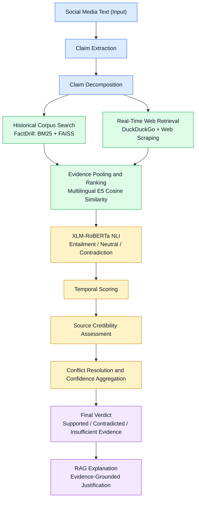

# TruthLens: Evidence-Aware Multilingual Misinformation Verification System

TruthLens is an end-to-end NLP and machine learning system designed to detect and verify misinformation in social media text. Built around the **FactDrill multilingual evidence corpus**, it combines historical fact-checking records with real-time web evidence to produce evidence-grounded verification results.

The system integrates **hybrid retrieval (BM25 + FAISS), real-time web retrieval, multilingual evidence ranking, XLM-RoBERTa Natural Language Inference (NLI), temporal and source credibility scoring, conflict resolution, and Retrieval-Augmented Generation (RAG) explanations**.

## Table of Contents

- [Key Features](#key-features)
- [System Architecture](#system-architecture)
- [Architectural Stages](#architectural-stages)
- [Machine Learning and Evaluation](#machine-learning-and-evaluation)
- [Repository Structure](#repository-structure)
- [Installation and Setup](#installation-and-setup)
- [Running the Project](#running-the-project)
- [Evaluation Visualizations](#evaluation-visualizations)
- [Technology Stack](#technology-stack)
- [Limitations](#limitations)

---

## Key Features

- **Claim Extraction:** Identifies the factual assertion from conversational or social media text.
- **Claim Decomposition:** Breaks complex statements into independently verifiable propositions.
- **Hybrid Evidence Retrieval:** Combines lexical BM25 retrieval and dense FAISS vector search.
- **Real-Time Web Retrieval:** Retrieves recent evidence using DuckDuckGo search and webpage extraction.
- **Multilingual Evidence Ranking:** Ranks candidate evidence using multilingual sentence embeddings.
- **Cross-Lingual Verification:** Uses XLM-RoBERTa to classify evidence relationships.
- **Temporal and Credibility Analysis:** Considers evidence recency, source credibility, and conflicting information.
- **Evidence-Grounded Explanations:** Generates explanations based on retrieved evidence.
- **Model Training and Hyperparameter Tuning:** Supports baseline evaluation, configuration comparison, and result visualization.
- **Interactive Web Interface:** Provides a React-based interface backed by a FastAPI service.

## System Architecture

TruthLens follows a dual-stream retrieval architecture in which historical evidence and real-time web evidence are combined before verification.



### Architectural Stages

1. **Claim Extraction:** Processes raw input to isolate the factual assertion while preserving relevant entities, numbers, and dates.

2. **Claim Decomposition:** Splits complex or multi-clause claims into smaller, independently verifiable propositions.

3. **Dual-Stream Retrieval:**
   - **Historical stream:** Searches the FactDrill evidence corpus using BM25 lexical retrieval and FAISS dense vector search. Reciprocal Rank Fusion (RRF) can combine the rankings.
   - **Real-time stream:** Searches web sources through DuckDuckGo and extracts relevant webpage content to incorporate recent information.

4. **Evidence Ranking:** Ranks the retrieved evidence using normalized embeddings from `intfloat/multilingual-e5-small`.

5. **XLM-RoBERTa Natural Language Inference:** Evaluates premise–hypothesis relationships using three classes:
   - `ENTAILMENT`
   - `NEUTRAL`
   - `CONTRADICTION`

   A directional relation check can help identify potentially incorrect entailment predictions for asymmetric claims.

6. **Temporal and Credibility Analysis:** Applies publication-recency scoring, source credibility weighting, evidence filtering, and competing-signal analysis. The implemented thresholds and weights should be interpreted according to the actual configuration used by the pipeline.

7. **Final Verdict:** Aggregates the verification signals into one of three outcomes:
   - `SUPPORTED`
   - `CONTRADICTED`
   - `INSUFFICIENT_EVIDENCE`

8. **RAG Explanation:** Produces a human-readable explanation grounded in retrieved evidence. Generated explanations should be checked against the cited sources.

---

## Machine Learning and Evaluation

TruthLens includes a separate training and evaluation workflow for optimizing the XLM-RoBERTa classification head using the FactDrill corpus.

The workflow supports baseline evaluation, hyperparameter grid search, held-out testing, and graphical analysis.

### Model Evaluation on the Held-Out Test Set

The following results represent the reported evaluation figures for the baseline and tuned configurations.

| Metric | Baseline Model | Tuned Model (Config-3) | Improvement |
|---|---:|---:|---:|
| Accuracy | 58.33% | **63.89%** | +5.56 percentage points |
| Macro Precision | 55.30% | **62.96%** | +7.66 percentage points |
| Macro Recall | 58.33% | **63.89%** | +5.56 percentage points |
| Macro F1-Score | 55.26% | **61.11%** | +5.85 percentage points |
| Weighted F1-Score | 55.26% | **61.11%** | +5.85 percentage points |

**Result interpretation:** The tuned model improves all five reported metrics over the baseline. However, the reported held-out test accuracy of 63.89% is lower than the best validation accuracy, so further testing and error analysis are needed before claiming strong generalization.

### Hyperparameter Grid Search

The following configurations compare learning rate, weight decay, dropout, and hidden-layer dimensions.

| Configuration | Learning Rate | Weight Decay | Dropout | Hidden Dim | Validation Accuracy | Validation Macro F1 |
|---|---:|---:|---:|---:|---:|---:|
| Config-1 | 0.0003 | 0.001 | 0.1 | 128 | 67.57% | 62.99% |
| Config-2 | 0.0005 | 0.010 | 0.2 | 256 | 67.57% | 62.76% |
| **Config-3 (Best)** | **0.001** | **0.010** | **0.2** | **256** | **78.38%** | **78.17%** |
| Config-4 | 0.002 | 0.050 | 0.3 | 512 | 70.27% | 69.10% |

**Best validation configuration:** Config-3, with a learning rate of `0.001`, weight decay of `0.010`, dropout of `0.2`, and hidden dimension of `256`.

The best validation configuration should not automatically be assumed to be the best-performing model on unseen data. The held-out test set is used for the final performance assessment.

### Training Artifacts

The training workflow is intended to store evaluation metrics, model checkpoints, and plots in the `results/` directory.

- `results/metrics.json` — baseline, tuned-model, and hyperparameter evaluation metrics.
- `results/models/best_xlm_r_head.pt` — trained classification-head checkpoint.
- `results/plots/` — training, evaluation, and comparison visualizations.

These paths depend on the training script's actual output configuration. Run the training workflow and verify that the artifacts exist before relying on them.

---

## Repository Structure

The main repository structure is organized as follows. Some generated files and optional artifacts may be absent until their corresponding scripts have been executed.

```text
Fake_TruthChecker/
│
├── scripts/
│   ├── data_preparation/
│   ├── retrieval/
│   ├── verification/
│   └── evaluation/
│
├── semantic_index/
│   ├── evidence.faiss
│   └── evidence_mapping.csv
│
├── truthlens-frontend/
│   ├── package.json
│   ├── src/
│   │   ├── App.jsx
│   │   └── App.css
│   └── vite.config.js
│
├── results/
│   ├── metrics.json
│   ├── models/
│   │   └── best_xlm_r_head.pt
│   └── plots/
│       ├── training_validation_curves.png
│       ├── hyperparameter_tuning_comparison.png
│       ├── baseline_vs_tuned_metrics.png
│       ├── confusion_matrix_baseline.png
│       └── confusion_matrix_tuned.png
│
├── factdrill_evidence_corpus.csv
├── truthlens.py
├── truthlens_api.py
├── train_and_evaluate.py
├── model_training_evaluation.ipynb
├── test_architecture_pipeline.py
├── list_models.py
├── requirements.txt
├── requirements-api.txt
├── .gitignore
├── .env.example
└── README.md
```

**Note:** The tree describes the intended organization. Ensure the filenames and generated artifacts match the actual repository before publishing documentation.

---

## Installation and Setup

### 1. Prerequisites

Install the following tools:

- Python 3.10 or later
- Node.js 18 or later and npm
- Git
- A code editor such as Visual Studio Code

The exact supported versions depend on the installed dependencies.

### 2. Clone the Repository

```bash
git clone https://github.com/ShikhTomar/Fake_TruthChecker.git
cd Fake_TruthChecker
```

### 3. Create a Virtual Environment

```bash
python -m venv .venv
```

Activate it on Windows PowerShell:

```powershell
.\.venv\Scripts\Activate.ps1
```

On Linux or macOS:

```bash
source .venv/bin/activate
```

### 4. Install Python Dependencies

Install the core project dependencies:

```bash
pip install -r requirements.txt
```

For API-specific dependencies, if required by the project:

```bash
pip install -r requirements-api.txt
```

### 5. Configure Environment Variables

Create a local `.env` file in the directory expected by the application. Use the following as a template, adapting the values to the configuration supported by your code:

```dotenv
GEMINI_API_KEY=your_gemini_api_key_here
GEMINI_MODEL=gemini-2.5-flash
GEMINI_FALLBACK_MODEL=gemini-1.5-flash
NLI_MODEL=symanto/xlm-roberta-base-snli-mnli-anli-xnli
```

Replace the placeholder API key with your own valid key. Do not commit `.env` to GitHub. Keep `.env.example` free of real credentials.

### 6. Install Frontend Dependencies

```bash
cd truthlens-frontend
npm install
cd ..
```

---

## Running the Project

Run the commands from the repository root unless otherwise indicated.

### A. Train and Evaluate the Model

Execute dataset preparation, baseline training, hyperparameter tuning, and result generation:

```bash
python train_and_evaluate.py
```

The script's actual implementation determines which stages execute and which artifacts are generated.

### B. Launch the Jupyter Notebook

For interactive model analysis and academic presentations:

```bash
jupyter notebook model_training_evaluation.ipynb
```

If Jupyter Notebook is not installed in the active environment, install it first:

```bash
pip install notebook
```

### C. Run the Command-Line Interface

Launch the claim-verification pipeline:

```bash
python truthlens.py
```

Follow the prompts displayed by the application.

### D. Start the FastAPI Backend

From the repository root:

```bash
uvicorn truthlens_api:app --host 127.0.0.1 --port 8000
```

If the API module or its dependencies require a different working directory, adjust the command accordingly.

The API is expected to expose the verification endpoint and health endpoint, subject to the implementation in `truthlens_api.py`.

- API base URL: `http://127.0.0.1:8000`
- Interactive API documentation: `http://127.0.0.1:8000/docs`

### E. Start the React Frontend

Open a second terminal:

```bash
cd truthlens-frontend
npm install
npm run dev
```

Open the local URL printed by Vite in your browser. The default is commonly:

`http://localhost:5173`

Ensure that the frontend's configured backend URL matches the running FastAPI service.

### F. Run Architecture Tests

Run the architecture and component verification script:

```bash
python test_architecture_pipeline.py
```

This script is intended to check pipeline components and their integration. Its actual test coverage depends on the implemented assertions.

---

## Evaluation Visualizations

The training and evaluation workflow can produce the following academic visualizations under `results/plots/`.

| Visualization | Purpose |
|---|---|
| `training_validation_curves.png` | Visualizes training loss and validation performance across epochs. |
| `hyperparameter_tuning_comparison.png` | Compares validation accuracy and Macro F1 across configurations. |
| `baseline_vs_tuned_metrics.png` | Compares baseline and tuned models across the reported evaluation metrics. |
| `confusion_matrix_baseline.png` | Shows baseline classification errors across the NLI classes. |
| `confusion_matrix_tuned.png` | Shows tuned-model classification errors across the NLI classes. |

These figures can support academic demonstrations, model comparison, and viva presentations. Their availability depends on successfully executing the relevant training and plotting code.

---

## Technology Stack

| Component | Technology |
|---|---|
| Programming Language | Python |
| Machine Learning | PyTorch, Transformers |
| Natural Language Inference | XLM-RoBERTa |
| Dense Evidence Retrieval | FAISS |
| Lexical Retrieval | BM25 |
| Multilingual Embeddings | Multilingual E5 |
| Web Retrieval | DuckDuckGo search and webpage extraction |
| Backend API | FastAPI |
| Frontend | React, Vite |
| Interactive Analysis | Jupyter Notebook |
| Version Control | Git and GitHub |

The table describes the intended stack; verify individual packages against the project's requirements files.

---

## Limitations

- Verification quality depends on the availability, relevance, and reliability of retrieved evidence.
- Real-time search results and webpage content may change or become unavailable.
- Multilingual claims may be affected by translation ambiguity, context, and model limitations.
- Source credibility and publication recency are useful signals but do not independently establish whether a claim is true.
- Classification confidence should not be interpreted as a guarantee of factual correctness.
- Reported model metrics apply to the evaluated dataset and split; further testing on independent and diverse data is necessary.

---

## Future Improvements

Potential future improvements include:

- Expanding multilingual and domain-specific evidence coverage.
- Improving retrieval quality and evidence deduplication.
- Evaluating temporal reasoning and source credibility methods independently.
- Conducting ablation studies to measure the contribution of each architecture component.
- Evaluating generalization on external fact-checking datasets.
- Improving confidence calibration and handling of insufficient evidence.
- Adding evidence provenance, source links, and transparent explanations to the interface.

---

## Conclusion

TruthLens combines historical fact-checking evidence, real-time retrieval, multilingual semantic ranking, natural language inference, and evidence-grounded explanations in a unified misinformation verification pipeline.

The project also incorporates model training, hyperparameter tuning, evaluation metrics, and graphical analysis to support reproducible experimentation and academic assessment.

**Project Repository:** [ShikhTomar/Fake_TruthChecker](https://github.com/ShikhTomar/Fake_TruthChecker)
